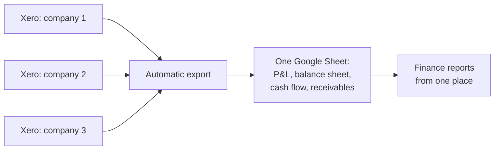

# Xero Multi-Entity Consolidation

## Problem
A group with three legal entities in three countries kept its books in three separate Xero organisations. Every report meant logging in to each organisation, exporting data and combining it by hand.

## How it works (in plain words)

Three companies keep separate books in Xero. The script collects data from all three into one spreadsheet, so finance no longer logs in to each company and combines exports by hand.

## Solution
A spreadsheet-bound Apps Script export that connects to all three organisations through **one Xero app with several tenants** (OAuth 2.0) and builds a consolidated reporting layer in Google Sheets: documents and line items, bank transactions, payments split by line item, balances, aging, AR/AP summary, cash flow by category, P&L (Xero report as source of truth plus a transaction layer), monthly balance sheet, bank reconciliation overview and document attachments on Google Drive.

## Engineering highlights
- **Quota-aware and resumable:** Xero allows 60 requests/min and 5,000/day per organisation. `xeroFetch()` reads the remaining quota from response headers, the export pauses before the limit, persists its state and resumes by trigger, so a multi-day history load never restarts.
- **Three run modes:** `testExport()` (TEST_ sheets, one entity), `startExport()` (full reload), `incrementalExport()` (only records changed since the last sync, updated in place).
- **Payment split by line item:** a payment against a multi-line invoice is allocated to the same P&L sections as the document; rounding goes to the last line so totals match exactly.
- **Reconciliation checks:** record counts vs. Xero, line allocation vs. document totals, bank movements vs. the Xero bank summary, missing P&L items vs. the Xero report.
- **Concurrency safety:** `LockService` around every run, because parallel runs rotate the Xero refresh token and break the connection.

## Files
| File | Purpose |
|---|---|
| `XeroAuth.js` | OAuth 2.0 for several organisations, tenant linking, `xeroFetch()` with quota handling |
| `XeroExport.js` | Export engine, sheets, reports, checks, menu |
| `Config.js`, `Logger.js` | Configuration and structured logging |

## Configuration
| Script Property | Required | Purpose |
|---|---|---|
| `XERO_CLIENT_ID` | yes | Xero app client ID |
| `XERO_CLIENT_SECRET` | yes | Xero app client secret |
| `XERO_COMPANIES` | yes | JSON: alias -> organisation name in Xero |
| `XERO_ATTACHMENTS_FOLDER_ID` | no | Drive folder for attachments; created automatically if empty |
| `LOG_LEVEL` | no | DEBUG, INFO, WARN or ERROR (default INFO) |

Bound to the reporting spreadsheet; the custom menu **Xero** appears on open. Authorize once per organisation, then run **Link organisations**.

## Setup
1. Create an Apps Script project (standalone or bound to a spreadsheet, see above).
2. Push the code with [clasp](https://github.com/google/clasp): copy `.clasp.json.example` to `.clasp.json`, set your `scriptId`, run `clasp push`. File order matters: `Logger.js` and `Config.js` must load first (`filePushOrder` is already set).
3. Add the Script Properties from `config.example.json` under **Project Settings > Script properties**.

## Logging
All modules log through `Log.debug / info / warn / error` (`Logger.js`): one structured entry per event with severity, message, context and stack trace, visible in **Executions** and **Google Cloud Logging**. Verbosity is controlled by the `LOG_LEVEL` Script Property.

## Result
All three entities' figures in one place without logging in to each organisation. About **5 hours saved per month**.
