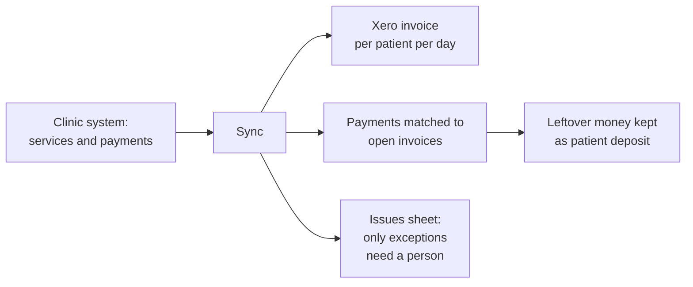

# Clinic Management System to Xero Sync

## Problem
Invoices and payments were created in a clinic management system (ClinicCards) and re-entered in Xero by hand, including matching every payment to the right invoice.

## How it works (in plain words)

Invoices and payments from the clinic system appear in Xero automatically, and payments are matched to the right invoices. The accountant only looks at the few cases listed in the Issues sheet.

## Solution
A spreadsheet-bound Apps Script sync between the clinic system API and Xero:
- **Invoices:** one Xero invoice per patient and day, each clinic service record as a separate line; a log sheet prevents duplicates, late records for an already uploaded day get a suffixed invoice and an entry in the Issues sheet.
- **Payments:** payments are grouped per patient, day and method, allocated to the patient's unpaid invoices (referenced invoice first, then oldest first); remainders become overpayments (patient deposits) that are allocated to new invoices later.
- **Reset:** voids old per-record invoices for a period and removes their payments, so a period can be reloaded with the new scheme.

## Engineering highlights
- Batch requests to Xero with per-element error checks; only successful groups are logged as processed, so a rerun picks up the failures
- Respects the Xero limit of 60 requests/min and the 6-minute Apps Script limit (stops early and asks to rerun)
- Every mismatch is written to the **Issues** sheet for the finance team
- Reference data (contacts, items, chart of accounts) can be synced into a handbook spreadsheet

## Files
| File | Purpose |
|---|---|
| `XeroClient.js` | Xero OAuth 2.0 client, `xeroApi_()`, handbook sync |
| `ClinicToXeroSync.js` | Invoice and payment upload, deposit allocation, reset, menu |
| `Config.js`, `Logger.js` | Configuration and structured logging |

## Configuration
| Script Property | Required | Purpose |
|---|---|---|
| `CLINICCARDS_API_KEY` | yes | Clinic system API key |
| `XERO_CLIENT_ID` | yes | Xero app client ID |
| `XERO_CLIENT_SECRET` | yes | Xero app client secret |
| `XERO_TENANT_ID` | no | Organisation to use; default = first connected |
| `XERO_CASH_ACCOUNT_ID` | yes | Xero bank account (AccountID) for cash payments |
| `XERO_CARD_ACCOUNT_ID` | yes | Xero bank account (AccountID) for card payments |
| `XERO_BANK_ACCOUNT_CODE` | no | Bank account code for the legacy daily sync |
| `SETTINGS_SHEET_GID` | yes | Sheet ID of the settings sheet with the period dates |
| `XERO_HANDBOOK_SPREADSHEET_ID` | no | Spreadsheet for Xero reference data |
| `XERO_HANDBOOK_SHEET_GIDS` | no | JSON: sheet IDs for contacts, items, accounts |
| `LOG_LEVEL` | no | DEBUG, INFO, WARN or ERROR (default INFO) |

Bound to the finance spreadsheet with the sheets Settings, Cash, Credit_card, CC_Invoices_Log, CC_Payments_Log and Issues; actions are in the custom menu.

## Setup
1. Create an Apps Script project (standalone or bound to a spreadsheet, see above).
2. Push the code with [clasp](https://github.com/google/clasp): copy `.clasp.json.example` to `.clasp.json`, set your `scriptId`, run `clasp push`. File order matters: `Logger.js` and `Config.js` must load first (`filePushOrder` is already set).
3. Add the Script Properties from `config.example.json` under **Project Settings > Script properties**.

## Logging
All modules log through `Log.debug / info / warn / error` (`Logger.js`): one structured entry per event with severity, message, context and stack trace, visible in **Executions** and **Google Cloud Logging**. Verbosity is controlled by the `LOG_LEVEL` Script Property.

## Result
Monthly reconciliation of the clinic system against Xero went from about **3 working days** to about **2 hours**.
