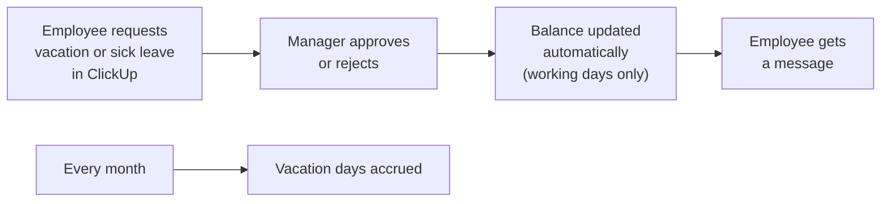

# Leave and Sick-Day Approval in ClickUp

## Problem
A 25-person agency handled vacation, overtime and sick-leave requests manually: approvals, balance tracking and monthly accruals took time and were error-prone.

## How it works (in plain words)

Employees request time off where they already work. Managers decide with one click, and remaining days are counted automatically, without manual tracking.

## Solution
A ClickUp webhook handled by an Apps Script web app (`doPost`):
- a new request task is read and linked to the employee record in the HR list
- the manager approves or rejects in ClickUp; approval deducts working days from the right balance (vacation, overtime days off, sick leave), excluding weekends and public holidays
- the employee receives a ClickUp direct message with the decision
- a monthly trigger accrues vacation days and resets yearly sick-leave balances
- every webhook event is processed only once (idempotency check) and logged

## Engineering highlights
- Idempotent webhook processing: ClickUp retries cannot double-deduct a balance
- Working-day calculation with public holidays
- All ClickUp field and option IDs come from configuration, so the same code runs on any workspace

## Files
| File | Purpose |
|---|---|
| `LeaveApproval.js` | Webhook, approval logic, balances, accruals, ClickUp API helpers |
| `Config.js`, `Logger.js` | Configuration and structured logging |

## Configuration
| Script Property | Required | Purpose |
|---|---|---|
| `CLICKUP_API_TOKEN` | yes | ClickUp personal or app token |
| `CLICKUP_WORKSPACE_ID` | yes | ClickUp workspace (team) ID |
| `CLICKUP_HR_LIST_ID` | yes | List with employee records and requests |
| `CLICKUP_FIELD_IDS` | yes | JSON: custom field IDs by purpose |
| `CLICKUP_REQUEST_TYPE_OPTIONS` | yes | JSON: dropdown option IDs of the request type field |
| `LOG_LEVEL` | no | DEBUG, INFO, WARN or ERROR (default INFO) |

Deploy as a web app and register its URL as a ClickUp webhook for task updates. Policy constants (days per year, monthly accrual) are at the top of `LeaveApproval.js`.

## Setup
1. Create an Apps Script project (standalone or bound to a spreadsheet, see above).
2. Push the code with [clasp](https://github.com/google/clasp): copy `.clasp.json.example` to `.clasp.json`, set your `scriptId`, run `clasp push`. File order matters: `Logger.js` and `Config.js` must load first (`filePushOrder` is already set).
3. Add the Script Properties from `config.example.json` under **Project Settings > Script properties**.

## Logging
All modules log through `Log.debug / info / warn / error` (`Logger.js`): one structured entry per event with severity, message, context and stack trace, visible in **Executions** and **Google Cloud Logging**. Verbosity is controlled by the `LOG_LEVEL` Script Property.

## Result
About **3 hours saved per month**, growing with every new team member.
