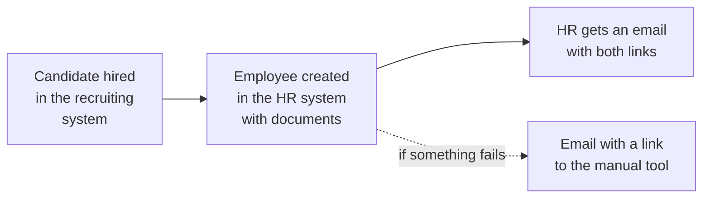

# ATS to HRIS Hiring Integration (Manatal to PeopleForce)

## Problem
When a candidate reached the offer or hired stage in the ATS (Manatal), HR re-created the employee in the HR system (PeopleForce) by hand: personal data, documents, position, salary and leave policies.

## How it works (in plain words)

When recruiters mark a candidate as hired, the employee profile is created in the HR system automatically. Nobody types the same data twice, and if something fails HR is told right away.

## Solution
A Manatal webhook handled by an Apps Script web app:
- on offer or hire, the employee is created or updated in PeopleForce with documents, avatar, position, salary, employment status and leave policies; the PeopleForce ID is written back to the ATS
- HR receives an email with links to both systems, or an error email with a link to the manual tool
- scheduled checks move candidates between pipeline stages after probation or termination and remind about equipment
- a manual tool in the spreadsheet covers edge cases

## Engineering highlights
- Webhook deduplication with `CacheService` and a script lock
- All pipeline stage IDs and HR policy IDs come from configuration, so the integration runs on any Manatal and PeopleForce account
- Errors are logged and reported by email instead of failing silently

## Files
| File | Purpose |
|---|---|
| `HiringIntegration.js` | Webhook, employee creation, scheduled checks, manual tool |
| `Config.js`, `Logger.js` | Configuration and structured logging |

## Configuration
| Script Property | Required | Purpose |
|---|---|---|
| `MANATAL_API_TOKEN` | yes | Manatal Open API token |
| `PEOPLEFORCE_API_KEY` | yes | PeopleForce API key |
| `PEOPLEFORCE_SUBDOMAIN` | yes | Your PeopleForce subdomain (for links in emails) |
| `HIRING_SPREADSHEET_ID` | yes | Spreadsheet with Logs, manual tool and handbooks |
| `MANUAL_HIRE_SHEET_GID` | yes | Sheet ID of the manual hire tool |
| `MANUAL_HIRE_HISTORY_SHEET_GID` | yes | Sheet ID of the manual hire history |
| `MANUAL_HIRE_TOOL_URL` | no | Link to the manual tool used in error emails |
| `MANATAL_STAGE_IDS` | yes | JSON: pipeline stage IDs by purpose |
| `PEOPLEFORCE_IDS` | yes | JSON: document type, probation, employment type, working pattern, pay schedule and leave policy IDs |
| `LOG_LEVEL` | no | DEBUG, INFO, WARN or ERROR (default INFO) |

Deploy as a web app and register its URL as a Manatal webhook. The PeopleForce custom field keys in the code must match the custom fields of your account.

## Setup
1. Create an Apps Script project (standalone or bound to a spreadsheet, see above).
2. Push the code with [clasp](https://github.com/google/clasp): copy `.clasp.json.example` to `.clasp.json`, set your `scriptId`, run `clasp push`. File order matters: `Logger.js` and `Config.js` must load first (`filePushOrder` is already set).
3. Add the Script Properties from `config.example.json` under **Project Settings > Script properties**.

## Logging
All modules log through `Log.debug / info / warn / error` (`Logger.js`): one structured entry per event with severity, message, context and stack trace, visible in **Executions** and **Google Cloud Logging**. Verbosity is controlled by the `LOG_LEVEL` Script Property.

## Result
The company works in outstaffing, so hiring runs continuously. Moving hired candidates from the ATS to the HRIS automatically saves managers about **2 hours of manual work per day**.
