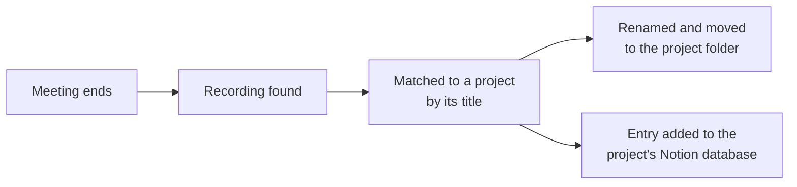

# Google Meet Recordings Router

## Problem
Google Meet saves recordings into the host's My Drive. Recordings had to be found, renamed, moved to the right client or project folder and logged in Notion by hand.

## How it works (in plain words)

Every call recording ends up in the right project folder with a clear name and a Notion entry. The team finds recordings by project instead of searching through someone's personal Drive.

## Solution
A scheduled Apps Script that, for every finished meeting:
- finds the recording via the Meet and Calendar APIs (service account with domain-wide delegation)
- matches the meeting to a project by keyword rules from the Routing sheet
- renames and moves the file into the project folder and cleans up empty Meet folders (trash, not delete)
- creates a page in the project's Notion database; columns are resolved by name or type, so differently structured databases work without setup
- offers a secret-protected web app endpoint so other automations can reuse the routing rules

## Engineering highlights
- `DRY_RUN` mode, backfill for past meetings, deduplication across hosts by video ID
- Error alerts by email with deduplication, so one recurring error does not spam the inbox
- Service account tokens built without external libraries

## Files
| File | Purpose |
|---|---|
| `MeetRecordingsRouter.js` | Routing, Drive moves, Notion pages, web app, setup and tests |
| `Config.js`, `Logger.js` | Configuration and structured logging |

## Configuration
| Script Property | Required | Purpose |
|---|---|---|
| `GOOGLE_SERVICE_ACCOUNT_KEY` | yes | Service account JSON key with domain-wide delegation |
| `NOTION_API_TOKEN` | yes | Notion internal integration secret |
| `ROUTING_SPREADSHEET_ID` | yes | Spreadsheet with Routing, Hosts and Log sheets |
| `ALERT_EMAIL` | yes | Recipient of error alerts |
| `WEBHOOK_SECRET` | yes | Shared secret for the web app endpoint |
| `FALLBACK_DRIVE_FOLDER_ID` | no | Folder for unmatched meetings |
| `FALLBACK_NOTION_DATABASE_ID` | no | Notion database for unmatched meetings |
| `LOG_LEVEL` | no | DEBUG, INFO, WARN or ERROR (default INFO) |

Run order: `setup()` -> fill the sheets -> `testAuth()` -> `run()` with `DRY_RUN = true` -> `DRY_RUN = false` -> time-based trigger for `run()`.

## Setup
1. Create an Apps Script project (standalone or bound to a spreadsheet, see above).
2. Push the code with [clasp](https://github.com/google/clasp): copy `.clasp.json.example` to `.clasp.json`, set your `scriptId`, run `clasp push`. File order matters: `Logger.js` and `Config.js` must load first (`filePushOrder` is already set).
3. Add the Script Properties from `config.example.json` under **Project Settings > Script properties**.

## Logging
All modules log through `Log.debug / info / warn / error` (`Logger.js`): one structured entry per event with severity, message, context and stack trace, visible in **Executions** and **Google Cloud Logging**. Verbosity is controlled by the `LOG_LEVEL` Script Property.

## Result
Removed a recurring manual task. Recordings are filed and logged automatically, so project documentation stays organised.
