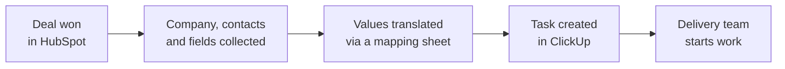

# HubSpot Closed-Won Deals to ClickUp

## Problem
When a deal was won in HubSpot, the delivery team re-created it as a task in ClickUp and copied company, contacts and custom fields by hand. Dropdown values differ between the two systems.

## How it works (in plain words)

When sales wins a deal, the delivery team gets a ready task with all customer details. Data is not copied by hand, so both systems show the same information.

## Solution
- HubSpot OAuth 2.0 in Apps Script (`apps-script-oauth2`)
- closed-won deals and form submissions are read via the HubSpot CRM API together with the associated company and contacts
- a ClickUp task is created with mapped custom fields; dropdown options are translated through a handbook sheet
- the handbook (HubSpot properties and options, ClickUp fields and users) refreshes automatically, so mapping changes need no code changes
- deal owners are matched to ClickUp users by email

## Engineering highlights
- Mapping lives in a spreadsheet, not in code: business users maintain it
- All list, field and sheet IDs come from configuration

## Files
| File | Purpose |
|---|---|
| `HubSpotToClickUp.js` | OAuth, HubSpot reads, ClickUp task creation, handbook refresh |
| `Config.js`, `Logger.js` | Configuration and structured logging |

## Configuration
| Script Property | Required | Purpose |
|---|---|---|
| `HUBSPOT_CLIENT_ID` | yes | HubSpot app client ID |
| `HUBSPOT_CLIENT_SECRET` | yes | HubSpot app client secret |
| `CLICKUP_API_TOKEN` | yes | ClickUp token |
| `CLICKUP_DEALS_LIST_ID` | yes | ClickUp list for new deals |
| `CLICKUP_FIELD_IDS` | yes | JSON: ClickUp custom field IDs by purpose |
| `HANDBOOK_SPREADSHEET_ID` | yes | Spreadsheet with settings, mapping and handbook sheets |
| `HANDBOOK_SHEET_GIDS` | yes | JSON: sheet IDs for settings, enumeration, submissions |
| `LOG_LEVEL` | no | DEBUG, INFO, WARN or ERROR (default INFO) |

Entry point for the time-based trigger: `syncHubSpotToClickUp()`. Authorize HubSpot once via the link from `syncClosedWonDealsToClickUp()`.

## Setup
1. Create an Apps Script project (standalone or bound to a spreadsheet, see above).
2. Push the code with [clasp](https://github.com/google/clasp): copy `.clasp.json.example` to `.clasp.json`, set your `scriptId`, run `clasp push`. File order matters: `Logger.js` and `Config.js` must load first (`filePushOrder` is already set).
3. Add the Script Properties from `config.example.json` under **Project Settings > Script properties**.

## Logging
All modules log through `Log.debug / info / warn / error` (`Logger.js`): one structured entry per event with severity, message, context and stack trace, visible in **Executions** and **Google Cloud Logging**. Verbosity is controlled by the `LOG_LEVEL` Script Property.

## Result
Removed manual re-entry of won deals. Customer data is consistent between HubSpot and ClickUp at the hand-off from sales to delivery.
