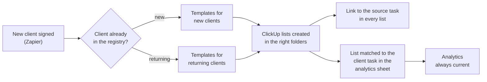

# ClickUp Client Lists from Templates

## Problem
Every new client needs its own set of ClickUp Lists, created from templates: for example a RACI list and a pipeline list. Which templates and which folders depend on the business unit and on whether the client is new or returning.

## How it works (in plain words)

As soon as a client is signed, the project team finds the client's lists ready in ClickUp, built from the right templates for that business unit. Every new list is automatically matched to the client's ClickUp task, so analytics always shows current data and nobody has to link lists and tasks by hand.

## Solution
An Apps Script web app called from a Zapier webhook:
- checks the client against a ClickUp registry List (by task name or by a custom field, closed tasks included)
- selects the List templates for `<unit>_<exists>` from a JSON mapping; one request can create several Lists
- creates each List from its ClickUp template in the target Folder or Space, with a name pattern (`RACI {client}`)
- adds a description with the client, a link to the source task and the date
- writes one row per created List (List ID, client, linked task ID, unit) to the records sheet that feeds analytics, so every List is matched to its client task
- returns the List IDs and URLs to Zapier for the next steps

## Engineering highlights
- **Config, not code:** templates, folders and name patterns per unit live in a JSON Script Property; `listTemplates()` finds template IDs, `validateConfig()` checks the mapping, registry and sheet after a change
- **Fits the webhook timeout:** a time guard answers before Zapier's 30-second limit and returns unprocessed jobs as `deferred`
- **One registry read per batch:** the registry is cached, so a batch of clients costs one API read
- **Partial failure is visible:** the response lists created, failed, rejected and deferred items separately; a failed description or log row never fails the List itself
- **Safe in parallel:** a lock keeps concurrent webhooks from writing the same log row; ClickUp rejects a duplicate List name in the same Folder, so webhook retries do not create duplicates
- Rate-limit handling (HTTP 429) with retries

## Files
| File | Purpose |
|---|---|
| `ClientListsFromTemplates.js` | Web app, registry check, List creation, records, admin tools |
| `Config.js`, `Logger.js` | Configuration and structured logging |

## Configuration
| Script Property | Required | Purpose |
|---|---|---|
| `CLICKUP_API_TOKEN` | yes | Token of a ClickUp service user |
| `WEBHOOK_SECRET` | yes | Shared secret the caller must send as `secret` |
| `CLICKUP_LIST_MAPPING` | yes | JSON: `<unit>_<true/false>` to an array of `{ templateId, folderTo or spaceTo, namePattern, options, descriptionTemplate }` |
| `CLICKUP_CLIENT_REGISTRY` | no | JSON: registry List ID, `matchBy` (`name` or `field`), `fieldId`, `includeClosed`, `cacheSeconds` |
| `CLICKUP_WORKSPACE_ID` | no | Only for `listTemplates()` |
| `RECORDS_SPREADSHEET_ID` | no | Spreadsheet for the log of created Lists |
| `RECORDS_SHEET` | no | JSON: tab and column keys of the log |
| `RECORDS_FIRST_COLUMN` | no | Column where the log row starts, 1 = A (default 4 = D) |
| `LOG_LEVEL` | no | DEBUG, INFO, WARN or ERROR (default INFO) |

Deploy as a web app (execute as you, access: anyone) and call it from a Zapier webhook step:
```json
POST { "secret": "<WEBHOOK_SECRET>", "client": "Client X", "unit": "Unit A", "linkedTask": "869abc123" }
```

## Setup
1. Create a standalone Apps Script project.
2. Push the code with [clasp](https://github.com/google/clasp): copy `.clasp.json.example` to `.clasp.json`, set your `scriptId`, run `clasp push`. File order matters: `Logger.js` and `Config.js` must load first (`filePushOrder` is already set).
3. Add the Script Properties from `config.example.json` under **Project Settings > Script properties**.
4. Run `listTemplates()` to get template IDs, fill in the mapping, then run `validateConfig()`.

## Logging
All modules log through `Log.debug / info / warn / error` (`Logger.js`): one structured entry per event with severity, message, context and stack trace, visible in **Executions** and **Google Cloud Logging**. Verbosity is controlled by the `LOG_LEVEL` Script Property.

## Result
Every new List is matched to its client task automatically, so analytics shows current data without manual linking. The project team gets its working Lists the moment a client is signed.
