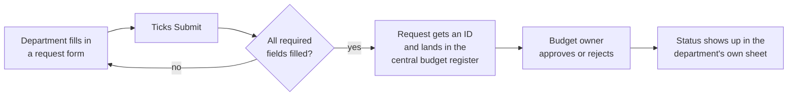

# Budget Payment Request Approval

## Problem
Several departments request payments from one budget. The budget owner needs every request in one place with a clear status, while each department should see and manage only its own requests and know when a decision is made.

## How it works (in plain words)

Each department works in its own spreadsheet and only sees its own requests. The budget owner sees every request in one register and decides there. A department can withdraw a request until it has been reviewed, never after.

## Solution
A Google Sheets system with one spreadsheet per department and one central register, connected by Apps Script:
- the department fills in rows on **Add Request** and ticks **Submit**; rows with missing required fields are named in an alert and nothing is sent
- each request gets a department-scoped ID (`MKT_42`) and is appended to the central register
- the budget owner reviews requests in the register (approval columns K:L)
- **Payment Request** in the department file mirrors the department's requests and their review status: after every action and every 15 minutes
- ticking the checkbox next to a request deletes it, only while the approval column is still empty

## Engineering highlights
- **Access by design:** the triggers run as their owner, so department users never get access to the central register
- **No duplicate IDs:** IDs are scoped by department, numbered from the highest existing one, and assigned under a lock
- **Safe writes:** rows are appended one by one (atomic), deletes re-check the exact row right before removing it
- **Clear feedback:** alerts name the incomplete rows; every action is logged with department and request IDs
- Plain Google Sheets: no extra tools or licences for the finance team

## Files
| File | Purpose |
|---|---|
| `BudgetRequests.js` | Submit, delete, status mirror, trigger setup |
| `Config.js`, `Logger.js` | Configuration and structured logging |

## Configuration
Set per department spreadsheet:

| Script Property | Required | Purpose |
|---|---|---|
| `BUDGET_REGISTER_SPREADSHEET_ID` | yes | Central register spreadsheet |
| `BUDGET_DEPARTMENT_CODE` | yes | Department code used as ID prefix (`MKT`) |
| `BUDGET_REQUIRED_FIELDS` | no | JSON: zero-based indexes of required columns in A:I (default `[0,1,3,5,6,7]`) |
| `LOG_LEVEL` | no | DEBUG, INFO, WARN or ERROR (default INFO) |

Sheet layout: department file with **Add Request** (B1 submit checkbox, requests from row 3, columns A:I) and **Payment Request** (column A delete checkboxes, B:M mirror); register with **Payments Requests** (A:L).

## Setup
1. Bind an Apps Script project to the department spreadsheet.
2. Push the code with [clasp](https://github.com/google/clasp): copy `.clasp.json.example` to `.clasp.json`, set your `scriptId`, run `clasp push`. File order matters: `Logger.js` and `Config.js` must load first (`filePushOrder` is already set).
3. Add the Script Properties from `config.example.json` under **Project Settings > Script properties**.
4. Run `installTriggers` once, signed in as a user with edit access to the register.

## Logging
All modules log through `Log.debug / info / warn / error` (`Logger.js`): one structured entry per event with severity, message, context and stack trace, visible in **Executions** and **Google Cloud Logging**. Verbosity is controlled by the `LOG_LEVEL` Script Property.

## Result
Runs across **10 department files**. Submission, numbering and status updates are fully automated, so nobody has to follow up on request statuses by hand.
