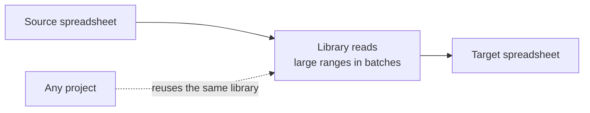

# Sheets API Toolkit (IMPORTRANGE replacement)

## Problem
IMPORTRANGE formulas between spreadsheets are hard to control: they recalculate on their own schedule, need manual access approval and become slow and fragile with many ranges.

## How it works (in plain words)

Moves data between spreadsheets on a schedule instead of live IMPORTRANGE formulas, also for data volumes that IMPORTRANGE cannot handle. Written once, reused in every project.

## Solution
A small Apps Script library on top of the **Sheets Advanced Service** that reads, writes and clears ranges in any spreadsheet by full URL (spreadsheet ID + `gid`), so data moves between files by script on a schedule instead of live formulas.

| Function | Purpose |
|---|---|
| `getValues(url, a1)` | Batch read via `batchGetByDataFilter` |
| `setValues(url, a1, values)` | Batch write via `batchUpdateByDataFilter` |
| `clearValuesSheets(url, a1)` | Batch clear via `batchClearByDataFilter` |
| `ensureEnoughRowsSheetsApi(url, a1, data)` | Expands rows/columns before a large write |
| `addBasicFilterSheetsApi` / `deleteBasicFilterSheetsApi` | Manage filters around bulk writes |
| `a1Notation2GridRange(url, a1)` | Converts A1 notation to a GridRange (sheet resolved from `gid`) |
| `getSpreadsheetIdFromUrl`, `getSheetIdFromUrl`, `columnsFromRange` | URL and range helpers |

## Usage
```javascript
const SRC = "https://docs.google.com/spreadsheets/d/SOURCE_ID/edit#gid=0";
const DST = "https://docs.google.com/spreadsheets/d/TARGET_ID/edit#gid=123";

const data = getValues(SRC, "A2:F").valueRanges[0].valueRange.values || [];
ensureEnoughRowsSheetsApi(DST, "A2:F", data);
clearValuesSheets(DST, "A2:F");
setValues(DST, "A2:F", data);
```
The Google Sheets advanced service is enabled in `appsscript.json`. Errors are logged through `Logger.js` (`LOG_LEVEL` Script Property). Can be deployed as an Apps Script library and shared across projects.

## Result
Works around the data-volume limits of IMPORTRANGE and replaces per-file formulas with one reusable library.

Credit: A1 to GridRange idea based on a gist by tanaikech.
